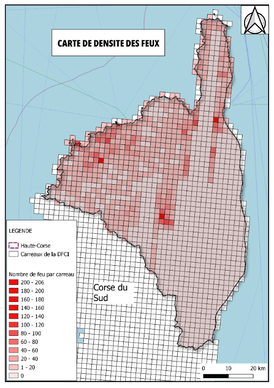
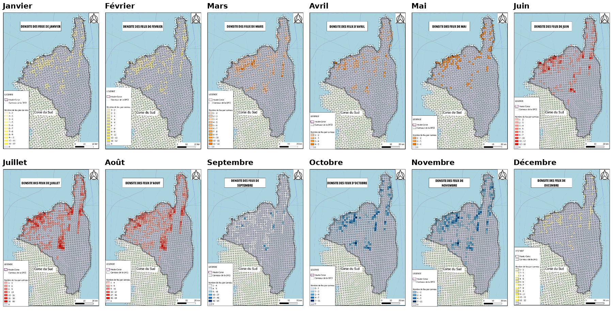
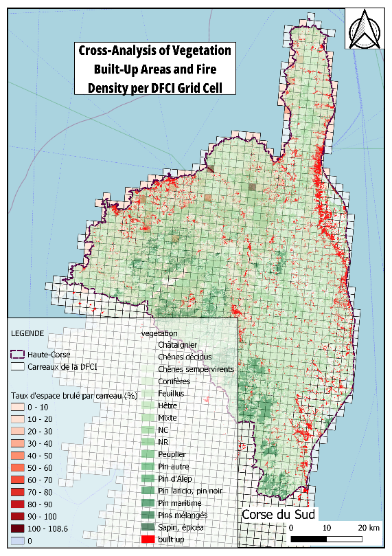
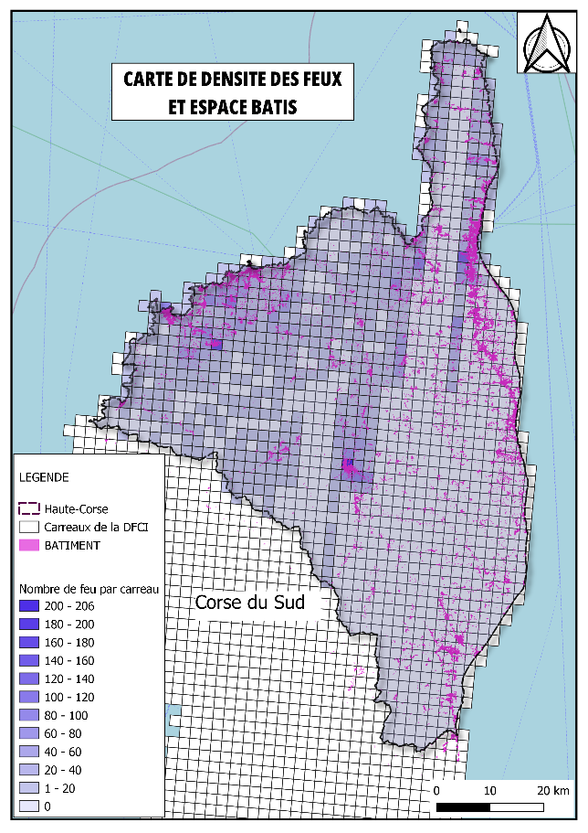

# Récurrence des feux de forêt en Haute-Corse (1973-2022)

> Analyse spatiale et saisonnière des incendies à la maille DFCI pour cibler les zones prioritaires de prévention.
> *Spatial and seasonal analysis of 50 years of wildfires in Haute-Corse (BDIFF × DFCI grid).*



**Master 1 Géomatique et modélisation spatiale (GMS)**, Aix-Marseille Université · 2025-2026
Cours *GIS and Spatial Analysis*, sous la direction de Sébastien Bridier · **Projet individuel** · Rapport en anglais

---

## Question

Où et quand les feux de forêt reviennent-ils le plus souvent en Haute-Corse, et quels facteurs (végétation, bâti) expliquent cette récurrence ?

## Données

| Donnée | Source | Usage |
|---|---|---|
| **BDIFF**, base de données des incendies de forêt en France (1973-2022) | Ministère de l'Agriculture | Événements de feu : année, mois, département, carreau |
| **Carroyage DFCI** (2 × 2 km) | Défense des forêts contre l'incendie | Unité d'analyse spatiale |
| **BD TOPO** (formations végétales, bâti) | IGN | Croisements avec la végétation et l'espace bâti |

## Méthode

1. **Choix du département.** Croisement BDIFF × DFCI à l'échelle nationale : une matrice départements × carreaux compte les passages du feu sur chaque carreau. La **Haute-Corse (2B)** arrive en tête avec **22 075 carreaux touchés** sur la période.
2. **Densité globale.** Nombre de feux par carreau DFCI sur 1973-2022, pour repérer les points chauds récurrents.
3. **Saisonnalité.** Agrégation mois par mois (carreaux × mois) et une carte par mois.
4. **Croisements.** Densité de feux × formations végétales, densité × espace bâti, puis les trois ensemble.

## Résultats clés

- **L'été concentre l'essentiel des feux** : août (**6 454** carreaux touchés), juillet (**4 063**) et septembre (**3 905**).
- **Le risque existe toute l'année** : novembre (349), mai (390) et décembre (407) restent non nuls.
- **Les points chauds coïncident avec le maquis, la garrigue et les forêts ouvertes**, des végétations très inflammables.
- **L'interface habitat-forêt** concentre les zones où le feu menace directement les secteurs bâtis.



| Croisement végétation × bâti × feux | Densité de feux et espace bâti |
|---|---|
|  |  |

## Apport pour l'aménagement

La maille DFCI permet de **hiérarchiser la prévention** : débroussaillement ciblé autour des zones bâties exposées, surveillance renforcée de juillet à septembre et vigilance en intersaison. La méthode est reproductible pour tout autre département méditerranéen.

## Outils

`QGIS` · `BDIFF` · `Carroyage DFCI` · `BD TOPO` · tableaux croisés dynamiques

## Contenu du dépôt

```
├── figures/   cartes finales (densité globale, 12 mois, croisements)
└── rapport/   rapport complet (PDF, anglais)
```

---

**Auteur :** Ezechiel Agbewanou SOUKOU, géomaticien-urbaniste · [LinkedIn](https://www.linkedin.com/in/ezechiel-soukou) · [Autres projets](https://github.com/ezekielofficiel7-spec)
